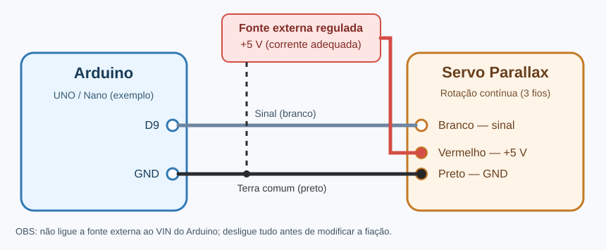

# EBG-20 + Arduino + Parallax 360° servo

**Serial Monitor control for a 3D-printed EBG-20 adaptive robotic gripper, using Arduino and a continuous-rotation Parallax servo.** This repository includes neutral-point calibration, short-pulse direction tests and continuous open/close/demo control.

**Original mechanical design:** the **Adaptive Robot Gripper EBG-20** was created by **[ToolBoxRobotics](https://toolboxrobotics.com/robotic-gripper-ebg20)**. Download the 3D model from the **[original Thingiverse project](https://www.thingiverse.com/thing:6460227)**. This is an *unofficial electronics/code adaptation*; it does not reproduce or redistribute the 3D design.

**[Português (Brasil)](README.md)**

## Hardware and wiring

The original gripper is intended for an **MG995 or higher positional servo**. This experimental adaptation uses a **three-wire Parallax continuous-rotation servo with a neutral-trim potentiometer**. The exact model number on the tested servo was not confirmed (similar functionality to Parallax 900-00008).

| Servo lead | Function | Arduino / power connection |
|---|---|---|
| White | Control signal | **D9** |
| Red | Power | **regulated +5 V** |
| Black | Ground | **GND** |

Use a regulated external 5 V supply sized for **servo load/stall current**, with **common GND** to the Arduino. Brief unloaded USB/Arduino 5 V calibration may work, but it is **not recommended** as a loaded-gripper power source. Do not connect an external 5 V supply to Arduino VIN.

Requires the standard Arduino **Servo.h** library (e.g., on Arduino UNO or Nano).

## Step 1 — Calibrate neutral

1. **Disconnect the servo from the gripper gears.**
2. Upload [`Calibrar_Neutro.ino`](Calibrar_Neutro/Calibrar_Neutro.ino).
3. The sketch commands **1500 µs** continuously on **D9**.
4. Gently turn the tiny servo trim screw until the shaft is **fully stopped**, without vibration or rotation.
5. **Do not force the trim potentiometer to its mechanical stop.** This sets the *stop/neutral pulse*, **not an angular travel limit**.

[Parallax manufacturer's documentation](https://www.parallax.com/products/parallax-continuous-rotation-servo/)

## Step 2 — Test directions and travel

1. Upload [`Teste_Passo.ino`](Teste_Passo/Teste_Passo.ino).
2. Open Arduino Serial Monitor at **9600 baud**.
3. `A` sends **1450 µs for 100 ms**; `D` sends **1550 µs for 100 ms**. Confirm the correct opening/closing directions for your assembly; invert pulse values if needed.
4. Starting physically open, count the pulses needed to approach the closed position **without pushing against hard stops**, then count the reverse direction.

This particular build was observed to take **14 closing pulses** and **15 opening pulses**, each of **100 ms**. The previous step-by-step controller used a cautious limit of **13 pulses**. These are empirical values, not absolute limits or degrees.

## Step 3 — Continuous movement sketch

Upload [`EBG20_Parallax_Arduino.ino`](EBG20_Parallax_Arduino/EBG20_Parallax_Arduino.ino). **Physically open the gripper before booting/resetting**: the firmware assumes the open position at startup.

| Serial command | Action |
|---|---|
| `A` | Close in one continuous movement |
| `D` | Open in one continuous movement |
| `C` | Demo: close normal → open normal → close slow → open slow |
| `P` | Interrupt currently running motion (position becomes unknown if interrupted during motion) |
| `Z` | Confirm the gripper is **physically open**; reset the internal virtual position to open |

**Sample parameters calibrated for this build:**

| Motion | Pulse | Time |
|---|---:|---:|
| Stop | 1500 µs | — |
| Normal close | 1450 µs | 1100 ms |
| Normal open | 1550 µs | 1200 ms |
| Slow close | 1470 µs | 1500 ms |
| Slow open | 1530 µs | 1650 ms |

**Adjust timing on your own assembly:** slower speed does not guarantee linear travel. Test unloaded, keep away from hard stops, then try the `C` demonstration while supervising it.

## Important limitations

- This is **time-based open-loop control**, not true position control. A continuous-rotation servo does not report shaft angle.
- Time limits do **not** detect a hard stop, a jam or an object. The servo can still damage the gripper's 3D-printed gears.
- `P` is checked during motion; it is **not immediately processed during the demo's 500 ms delays**. Cut the servo power if stalled.
- Power voltage, load and friction affect travel. Position may drift over repeated cycles.
- `Z` sets only a **software reference**. It does not home or move the gripper.
- For reliable gripping, consider **limit switches or a feedback-enabled actuator**.

## Credits and license

- **3D model and mechanical engineering:** [ToolBoxRobotics — EBG-20](https://www.thingiverse.com/thing:6460227). Check its own license before sharing model files.
- **Continuous-rotation servo documentation:** [Parallax](https://www.parallax.com/products/parallax-continuous-rotation-servo/).
- **This repository:** Arduino control examples and adaptation documentation are shared under [MIT](LICENSE). **The original 3D model is not included and is not covered by this repository's license.**
