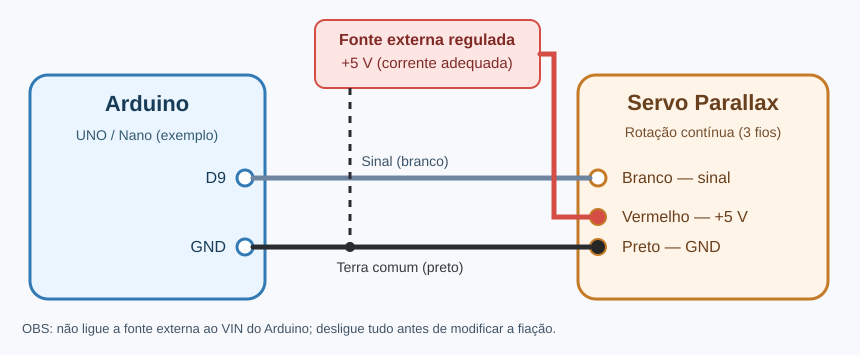

# EBG-20 + Arduino + servo Parallax 360°

**Controle por Monitor Serial de uma garra robótica adaptativa EBG-20 impressa em 3D, utilizando Arduino e servo Parallax de rotação contínua.** Inclui calibração do ponto neutro, teste de movimento por pulsos e um programa para abrir, fechar e demonstrar a garra em movimento contínuo.

> **Créditos pelo projeto mecânico:** a garra **Adaptive Robot Gripper EBG-20** foi criada por **[ToolBoxRobotics](https://toolboxrobotics.com/robotic-gripper-ebg20)**. O modelo 3D e os arquivos de impressão são do criador original: **[Thingiverse — EBG-20 (thing:6460227)](https://www.thingiverse.com/thing:6460227)**. Este repositório compartilha apenas código e instruções da adaptação eletrônica: **não é um projeto oficial da ToolBoxRobotics e não redistribui os modelos 3D**.

**[English README](README.en.md)**

## 1. Sobre a adaptação

O modelo original da EBG-20 foi descrito pela ToolBoxRobotics para servo de posição **MG995 ou superior**. Nesta montagem experimental foi usado um **Parallax de rotação contínua, com três fios e potenciômetro de ajuste do neutro** (sem confirmação do código exato na carcaça; comportamento semelhante ao modelo Parallax 900-00008).

**Diferença fundamental:** em um servo de rotação contínua, `1500 µs` representa parada aproximada; valores acima e abaixo comandam sentido/velocidade. **Não existe posição por ângulo**. Aqui, os limites da garra são estimados **por tempo**, não medidos por sensores.

## 2. Materiais

- Garra EBG-20 impressa em 3D (obtenha as peças na página do criador);
- 1 Arduino compatível com a biblioteca `Servo.h` (por exemplo, UNO ou Nano);
- 1 servo Parallax de rotação contínua, 3 fios, ajuste de neutro;
- Cabos jumper e cabo USB para programar;
- Uma chave de fenda pequena para ajustar o potenciômetro do servo;
- **Recomendado para uso montado:** alimentação **regulada de 5 V**, com capacidade de corrente suficiente para o servo sob carga, e GND comum ao Arduino.

**Biblioteca:** `Servo.h`, normalmente incluída no ambiente Arduino AVR. Não são necessárias bibliotecas de terceiros.

## 3. Ligações

| Fio do Parallax | Função | Conectar |
|---|---|---|
| **Branco** | Sinal de controle | **D9** do Arduino |
| **Vermelho** | Alimentação | **+5 V regulados** |
| **Preto** | Terra | **GND** |



**Energia:** é possível que um servo desacoplado funcione no pino 5 V de um Arduino alimentado via USB durante uma calibração breve, mas **não é uma alimentação recomendada para a garra trabalhando**. Sob esforço, o servo pode causar quedas de tensão, reinícios e sobrecarga. Para operação montada, use fonte externa regulada de 5 V com capacidade adequada; conecte **GND da fonte ao GND do Arduino**. Não conecte 5 V externo ao `VIN` do Arduino nem alimente o servo com fonte não regulada. Desligue a alimentação antes de alterar a fiação.

## 4. Etapa 1 — Calibrar o ponto neutro com a chave

1. **Desacople o servo das engrenagens** da garra para evitar esforço involuntário.
2. Abra [`Calibrar_Neutro/Calibrar_Neutro.ino`](Calibrar_Neutro/Calibrar_Neutro.ino) na Arduino IDE.
3. Selecione placa e porta e envie o programa. Ele mantém o comando `servo.writeMicroseconds(1500)` no pino **D9**.
4. Observe o eixo: se estiver girando ou vibrando, localize o **pequeno potenciômetro de ajuste** acessível pela carcaça do Parallax.
5. Com chave de fenda pequena, gire em incrementos **mínimos** até o eixo ficar **completamente parado**. Se aumentar a velocidade, retorne no sentido oposto.
6. **Não force o ajuste até o fim.** Ele calibra o ponto de **parada**, não o limite de curso da garra.

Este procedimento corresponde à orientação da [documentação da Parallax](https://www.parallax.com/products/parallax-continuous-rotation-servo/) para servos de rotação contínua com ajuste de neutro.

## 5. Etapa 2 — Testar os sentidos e contar os pulsos

1. Com a garra livre e sem objetos, abra [`Teste_Passo/Teste_Passo.ino`](Teste_Passo/Teste_Passo.ino).
2. Envie para o Arduino e abra o **Monitor Serial a 9600 baud**.
3. Pressione **A** para um pulso de `1450 µs` por `100 ms`; pressione **D** para um pulso de `1550 µs` por `100 ms`.
4. Confirme qual direção **fecha** e qual **abre**. Inverta os pulsos no código caso seu mecanismo esteja montado no sentido contrário.
5. Parta da garra fisicamente aberta e conte os pulsos necessários para chegar **perto do fechamento**, sem forçar o batente. Conte também os pulsos de volta à abertura.

**Resultado observado nesta montagem:**

| Teste | Resultado |
|---|---:|
| Fechamento, sentido `A` (`1450 µs`) | 14 pulsos de 100 ms até o fechamento completo |
| Abertura, sentido `D` (`1550 µs`) | 15 pulsos de 100 ms até a abertura completa |
| Margem no controle inicial por pulsos | 13 pulsos para evitar chegar ao batente |

Esses números são **observações empíricas**, e não medidas de ângulo ou limites garantidos. A mecânica, o atrito e a tensão de alimentação afetam o resultado. **Não continue acionando quando a garra alcançar o limite físico.**

## 6. Etapa 3 — Controle final contínuo

Abra [`EBG20_Parallax_Arduino/EBG20_Parallax_Arduino.ino`](EBG20_Parallax_Arduino/EBG20_Parallax_Arduino.ino) e envie para a placa. O servo agora faz **um movimento contínuo** na abertura/fechamento: não fica parando entre os dentes.

**Antes de carregar ou reiniciar:** coloque a garra **fisicamente aberta**, na referência zero, pois o programa inicia com essa suposição.

No **Monitor Serial a 9600 baud**, envie:

| Comando | Função |
|---|---|
| `A` | Fecha com um movimento contínuo |
| `D` | Abre com um movimento contínuo |
| `C` | Demonstração completa: fecha normal → abre normal → fecha lento → abre lento |
| `P` | Tenta interromper o movimento atual; a posição passa a ser desconhecida se for interrompida durante o giro |
| `Z` | **Somente depois de abrir a garra manualmente**, informa ao programa que a posição é zero (aberta) |

**Parâmetros usados na montagem:**

| Movimento | Sinal | Duração estimada |
|---|---:|---:|
| Parar | 1500 µs | — |
| Fechar normal | 1450 µs | 1100 ms |
| Abrir normal | 1550 µs | 1200 ms |
| Fechar lento | 1470 µs | 1500 ms |
| Abrir lento | 1530 µs | 1650 ms |

> **Importante:** os tempos do programa final **não são resultado de sensor de posição** e foram escolhidos a partir de testes manuais. A duração “lenta” precisa de verificação separada: a relação entre pulso, velocidade e deslocamento não é perfeitamente proporcional. Ajuste os parâmetros para **parar com folga antes dos batentes**, primeiro sem objetos e com supervisão.

### Como testar com segurança

1. Faça a calibração de neutro **sem engrenagens acopladas**.
2. Verifique os sentidos com os pulsos curtos.
3. Com a garra montada, **inicie aberta**, sem objetos.
4. Teste **A** uma vez, observando o curso; **interrompa se estiver perto do batente**.
5. Teste **D** e confirme o retorno.
6. Só depois experimente **C**; tenha o botão de desligar a alimentação ao alcance.
7. Se a posição real não corresponder à posição esperada, **não use Z para “voltar” a garra**: reposicione-a fisicamente aberta e só então envie `Z`.

## 7. Limitações e segurança

- O Parallax de rotação contínua **não fornece feedback de posição**. Um contador ou temporizador **não protege fisicamente** as engrenagens.
- O programa **não detecta travamentos, objetos ou fim de curso**. Pode forçar as engrenagens mesmo quando o tempo ainda não terminou.
- `P` é lido enquanto o motor está no laço de movimento; **durante as pausas de 500 ms da demonstração o comando não é tratado imediatamente**. Se houver travamento, **desligue a alimentação**.
- Os tempos calibrados mudam com carga, alimentação, desgaste e montagem; a “posição” pode derivar após alguns ciclos.
- `Z` apenas define uma **referência virtual** — **não movimenta nem detecta** a garra.
- Para uso repetitivo ou para segurar objetos com segurança, considere **dois fins de curso**, um **sensor de posição** ou outro acionamento com feedback. Uma fonte de alimentação adequada é indispensável.

## 8. Arquivos

```text
EBG20-Parallax-Arduino/
├── README.md                           # Tutorial em português
├── README.en.md                        # English guide
├── Calibrar_Neutro/
│   └── Calibrar_Neutro.ino              # Ajustar o servo em 1500 µs
├── Teste_Passo/
│   └── Teste_Passo.ino                  # A/D: pulsos curtos de 100 ms
├── EBG20_Parallax_Arduino/
│   └── EBG20_Parallax_Arduino.ino       # A/D/C/P/Z, movimento contínuo
├── docs/
│   └── ligacao.svg                     # Esquema de ligação
└── LICENSE                             # Licença do código deste repo
```

## 9. Créditos e licença

- **Design 3D original:** [ToolBoxRobotics — EBG-20 (Thingiverse)](https://www.thingiverse.com/thing:6460227) e [site do criador](https://toolboxrobotics.com/robotic-gripper-ebg20). Consulte as condições de licença **na própria página do modelo** antes de redistribuir arquivos STL/STEP.
- **Servo:** [Parallax Continuous Rotation Servo — documentação do fabricante](https://www.parallax.com/products/parallax-continuous-rotation-servo/).
- **Adaptação Arduino:** testes, ligação, calibração e controle por tempo documentados neste repositório.
- O código e os textos **deste repositório** são disponibilizados sob a licença [MIT](LICENSE), **sem abranger arquivos ou direitos do design mecânico original**.
